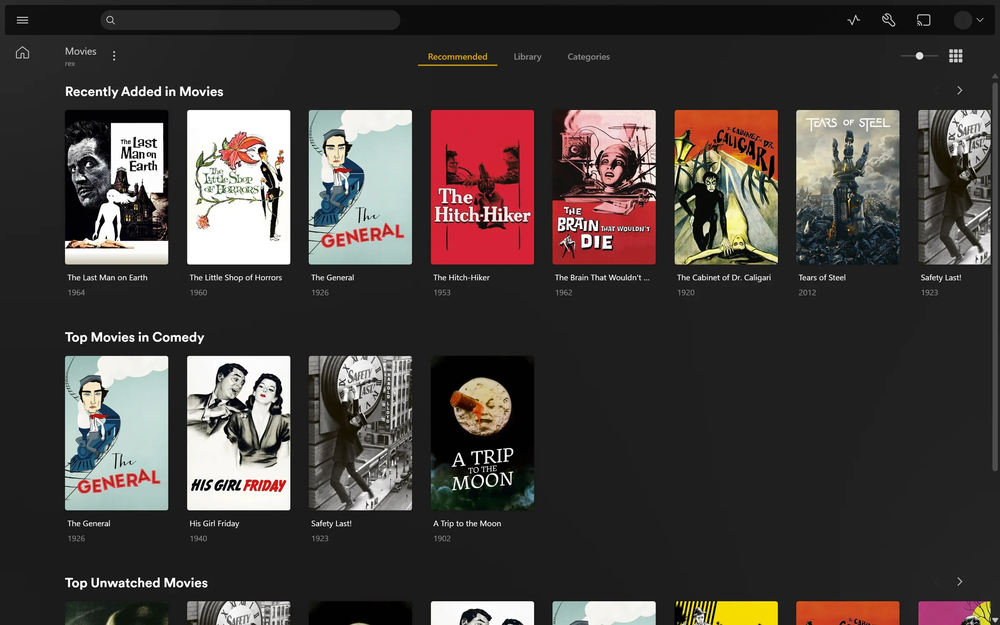
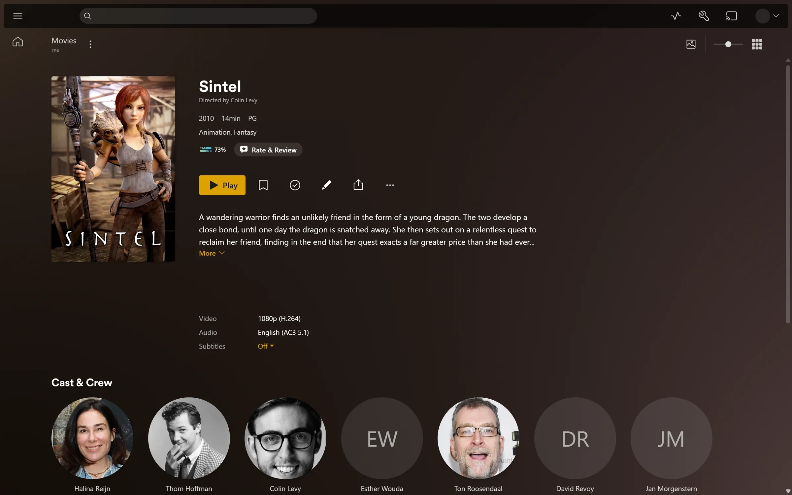
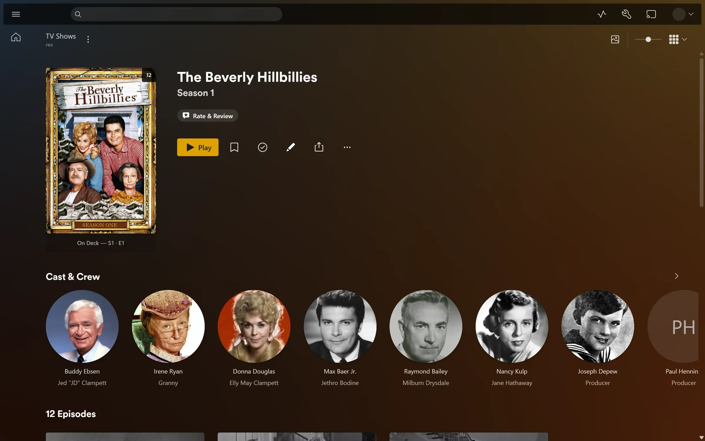
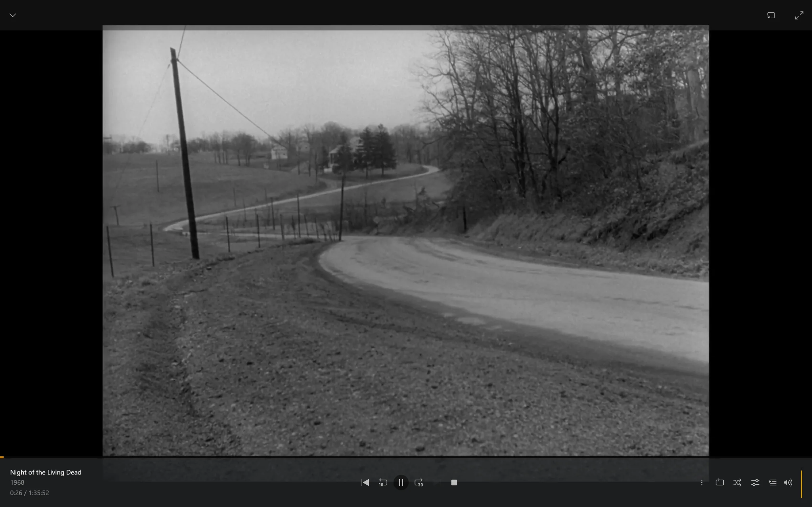
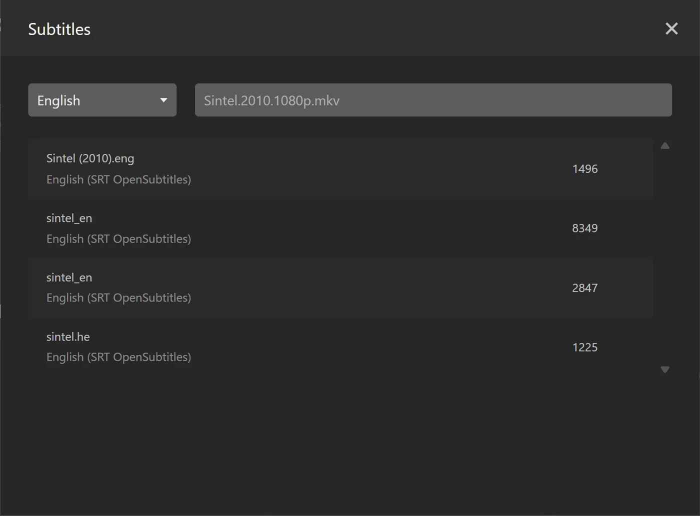
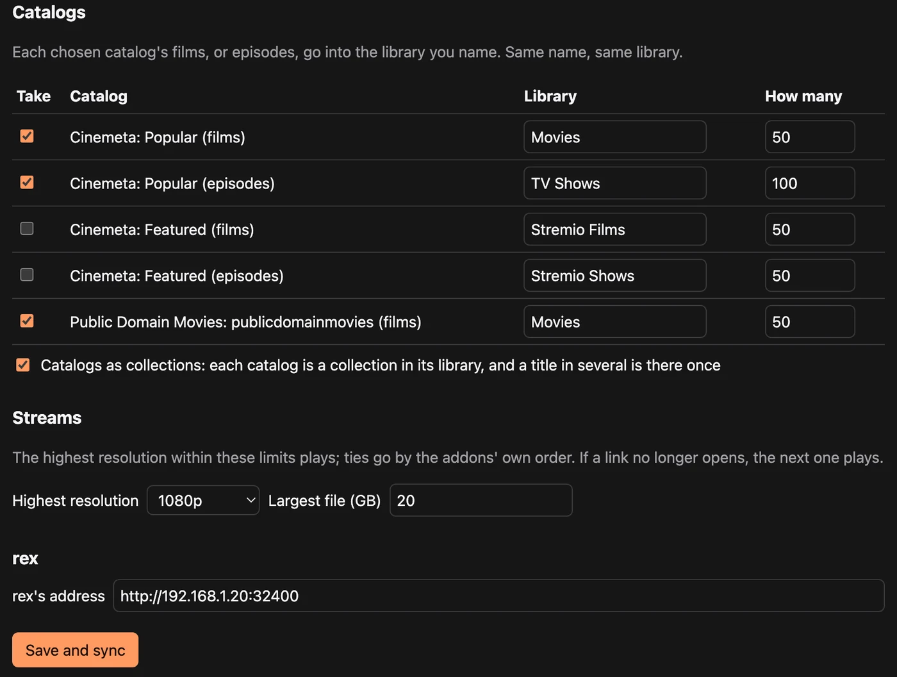

<h1 align="center">rex</h1>

<b>Any source. Every Plex app. A media server that owns no files.</b>

  <a href="https://rex.debridmediamanager.com">Website</a> ·
  <a href="https://github.com/debridmediamanager/rex/releases">Download</a> ·
  <a href="https://notes.debridmediamanager.com/rex/">Docs</a> ·
  <a href="https://notes.debridmediamanager.com/rex/faq/">FAQ</a> ·
  <a href="https://discord.com/invite/7u4YjMThXP">Discord</a>

https://github.com/user-attachments/assets/541345b9-1cdd-4411-b536-2beeba9b0204

Your movies and shows stay on a debrid service, a Usenet provider or any web server. rex shows them to the Plex apps as a normal server, and when you press play it streams the file straight from where it lives. Nothing is downloaded first and nothing is scanned: a title appears as soon as its source tells rex about it.

| | |
|---|---|
|  |  |
|  |  |

Real screenshots of Plex Web on rex, with public domain films and open movies streamed from a plain web server.

## What you get

- **Looks like any other Plex server.** Posters, summaries, cast, seasons and episodes from Plex's own metadata. Watched state, Continue Watching, playlists, collections, edits and Fix Match all work and survive a restart.
- **Original quality, straight from the source.** With [jellyfin-ffmpeg](docs/setup.md#which-ffmpeg) installed rex also converts what a device cannot play; on a small Intel GPU a converted 1080p film starts in about 2 seconds.
- **Subtitles that fit.** Search Subtitles uses Plex's own provider. rex checks the one you pick against a text subtitle in the file, or its audio when FFmpeg is installed, and fixes the timing when it is off.
- **Many sources, one library.** Your debrid accounts, your Stremio addons and an app of your own can all fill the same Movies and TV Shows libraries.
- **No Plex Pass.** Remote playback in Plex Web and converting video work on free accounts. So do movie editions, the server Dashboard, Downloads and, with FFmpeg, intro and credits skipping ([what works](docs/setup.md#movie-and-tv-capabilities)).
- **Free for personal use**, with the source code public and nightly builds.

| Search Subtitles | Original quality, or converted |
|---|---|
|  |  |

## Get started

Pick the guide for what you have.

| You have | Guide |
|---|---|
| Files your own app serves over HTTP | [rex with your own app](https://notes.debridmediamanager.com/rex/any-source/) |
| Stremio addons | [rex with your Stremio addons](https://notes.debridmediamanager.com/rex/stremio/), free, with no sponsorship |
| Your debrid library or Usenet, through zurg | [rex with zurg](https://notes.debridmediamanager.com/rex/with-zurg/) |
| A Plex server today | [Move from Plex to rex](https://notes.debridmediamanager.com/rex/from-plex/) |

In short:

1. **Get it.** [Download](https://github.com/debridmediamanager/rex/releases) the newest build for Linux (glibc 2.35 or newer, so Ubuntu 22.04 and up), macOS or Windows, run the [Docker image](docs/setup.md#docker) `ghcr.io/debridmediamanager/rex:nightly` on Linux, or build it with Rust.
2. **Start it.** It makes an empty Movies and an empty TV Shows library.
3. **Claim it** with a code from [plex.tv/claim](https://www.plex.tv/claim) on a fresh free Plex account, and share it with your own. At your own risk: rex is not made by Plex, and Plex could act against the account that claims it.
4. **Point a source at it.** Give it `http://<rex's LAN IP>:32400` and it registers itself: for zurg that is `rex_url` in its `config.yml`, for rex-stremio **rex's address** on its settings page, for your own app the [feed API](docs/feed-api.md).
5. **Forward port 32400** to rex to watch away from home. rex-direct gives rex an HTTPS address for that, and one for home that app.plex.tv uses with no port forward. [Check them](docs/setup.md#7-reach-it-from-outside-https-and-the-announce) from home and from a phone off Wi-Fi.

You need rex nightly 2026.10.25 or newer and, for zurg, zurg nightly 2026.10.27 or newer (a sponsor build. [gatekeeper](https://gatekeeper.debridmediamanager.com/) gives your GitHub account access). [docs/setup.md](docs/setup.md) has every command, Windows, Docker, running it as a service, updates and a troubleshooting table.

Two things to know first. Deleting a title in a Plex app as the claiming account deletes it at its source too, from your debrid account for zurg; untick **Allow media deletion** (Settings, Library, Show Advanced) to stop that. And a reverse proxy or tunnel on the rex machine must block `/rex/`, or it opens rex's feed to the internet.

Once it runs: [share it with family and friends](https://notes.debridmediamanager.com/rex/sharing/), [bring your watch history](https://notes.debridmediamanager.com/rex/import-watched/) from your old Plex server, [add Kometa collections](https://notes.debridmediamanager.com/rex/kometa/), or [let the apps download from your provider](https://notes.debridmediamanager.com/rex/direct-download/).

## Sources and addons

rex reads no media from disk. A source (an addon, your own app or zurg) tells rex what files it has and what is in them over the [feed API](docs/feed-api.md), and serves them when you press play.

| Source | What it brings |
|---|---|
| [rex-stremio](https://github.com/debridmediamanager/rex-stremio) | Your Stremio addons' catalogs, played from your stream addons |
| [zurg](https://zurg.debridmediamanager.com/) | Your debrid accounts and Usenet |
| [rex-live-sports](https://github.com/debridmediamanager/rex-live-sports) | The channels of a live-sports server, played live |
| Your own | [Building rex addons](https://notes.debridmediamanager.com/rex/addons/) walks through one |

## Limits

- Movies and TV only. Music and photo libraries stay empty. There is no tuner or DVR, though an addon can bring live channels.
- A title shows up only once its source has probed it. A source's first pass over a big library can take a few hours.
- Away from home rex needs an address of its own: rex-direct, or a certificate for a hostname you own. rex has no relay, so behind CGNAT use Tailscale or a small VPS ([how](https://notes.debridmediamanager.com/rex/any-source/#use-it-outside-your-home-optional)).
- Downloads for offline viewing leave text subtitles out.
- Remote playback on free accounts is checked in Plex Web only; the other Plex apps have not been tested away from home on free accounts.
- It started as an experiment and got further than expected. It is not a product and does not try to replace Plex.

## For developers

rex is written in Rust. [CLAUDE.md](CLAUDE.md) covers the code, the tests and how every behaviour was measured against a real Plex Media Server, and [docs/findings.md](docs/findings.md) is the record of those measurements. [docs/feed-api.md](docs/feed-api.md) is the API a source uses to push its library.

## License

[PolyForm Noncommercial 1.0.0](LICENSE): free for personal, hobby, educational and other noncommercial use. Commercial use is not allowed. Copies must keep the license and its `Required Notice` line, which credits the author. The Docker image also carries [jellyfin-ffmpeg](https://github.com/jellyfin/jellyfin-ffmpeg) (GPL), unmodified, from its own releases.

rex is an independent project, not affiliated with or endorsed by Plex, Inc. Plex is a trademark of Plex, Inc.

---

**More from DMM:** [Debrid Media Manager](https://debridmediamanager.com/) · [zurg](https://zurg.debridmediamanager.com/) · [rex](https://rex.debridmediamanager.com/) · [Docs](https://notes.debridmediamanager.com/) · [Sponsor](https://gatekeeper.debridmediamanager.com/) · [Discord](https://discord.com/invite/7u4YjMThXP) · [Reddit](https://www.reddit.com/r/debridmediamanager/)
