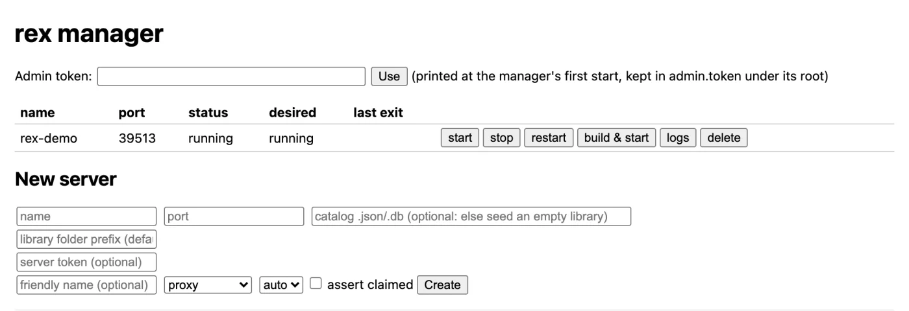

# Setting up rex

The [README](../README.md) has the short version. This is the full one.

## The steps

A rex server is four things: the binary, a **catalog** (its identity and two empty
libraries, made on its first start), the **sources** that register with it, push the
library and serve its bytes, and, if it is to appear in your Plex apps, a **claim** on a
Plex account (a fresh one, shared with yours: step 5) and, for use outside your LAN, an
HTTPS address. rex starts once (step 4), and nothing after that needs a restart. The steps below go through it in order.

### What you need

| | |
|---|---|
| A Linux, macOS or Windows host | rex is one binary with no other runtime dependencies |
| 1 GB of RAM | with 4,062 movies and 656 shows (34,678 episodes) rex used under 500 MB while it started and about 730 MB while the library was browsed; converting video takes more |
| rex nightly 2026.10.25 or newer | download it ([step 1](#1-get-it)), run the [Docker image](#docker) on Linux, or build it with Rust 1.89 or newer (rustup) |
| One or more sources | anything that serves the files over HTTP and pushes them to rex's feed: [rex-stremio](https://github.com/debridmediamanager/rex-stremio) for Stremio addons, [zurg](https://zurg.debridmediamanager.com/) nightly 2026.10.27 or newer for a debrid account or Usenet (zurg v1.0.0 has no rex feed), or your own |
| An HTTPS address | only for use outside your LAN: rex-direct, on by default once claimed (step 7), or a certificate for a hostname you control (a `tailscale cert`, Let's Encrypt) |
| FFmpeg | optional, for [transcoding](#transcoding) |

### 1. Get it

There are builds on [Releases](https://github.com/debridmediamanager/rex/releases) for Linux (amd64 and arm64, glibc 2.35 or newer, so Ubuntu 22.04 and up), macOS (Intel and Apple Silicon) and Windows (64 bit). This takes the newest for your machine into `~/rex`:

```bash
mkdir -p ~/rex && cd ~/rex
TAG=$(curl -fsSL 'https://api.github.com/repos/debridmediamanager/rex/releases?per_page=1' | sed -n 's/.*"tag_name": *"\([^"]*\)".*/\1/p' | head -1)
P=$(uname -s | tr A-Z a-z)-$(uname -m | sed 's/x86_64/amd64/;s/aarch64/arm64/')
curl -fL "https://github.com/debridmediamanager/rex/releases/download/$TAG/rex-$TAG-$P.tar.gz" | tar xz --strip-components=1
```

On Windows, in PowerShell (then see [Windows](#windows)):

```powershell
New-Item -ItemType Directory -Force $HOME\rex | Out-Null; cd $HOME\rex
$tag = (Invoke-RestMethod 'https://api.github.com/repos/debridmediamanager/rex/releases?per_page=1')[0].tag_name
curl.exe -fLO "https://github.com/debridmediamanager/rex/releases/download/$tag/rex-$tag-windows-amd64.zip"
tar -xf "rex-$tag-windows-amd64.zip" --strip-components=1; Remove-Item "rex-$tag-windows-amd64.zip"
```

A macOS build downloaded in a browser instead is stopped by Gatekeeper: run `xattr -dr com.apple.quarantine .` in its folder.

On Linux, the same build also comes as the Docker image `ghcr.io/debridmediamanager/rex:nightly`, set up in [Docker](#docker).

Or build it (Rust 1.89 or newer from rustup, as distro packages are often older):

```bash
git clone https://github.com/debridmediamanager/rex && cd rex
cargo build --release --manifest-path rust/Cargo.toml       # -> rust/target/release/rex
```

A checkout runs `rust/target/release/rex` wherever this guide says `./rex`.

Without a Rust toolchain on the host, build in Docker. The binary runs on any Linux of the
same architecture with glibc 2.31 (Debian 11's) or newer:

```bash
docker run --rm -u "$(id -u):$(id -g)" -e HOME=/tmp -v "$PWD":/src -w /src/rust \
  -e CARGO_TARGET_DIR=/src/rust/target rust:1-bullseye cargo build --release
```

### 2. Sources: where the library and its bytes come from

rex reads no disk and lists nothing, and nothing about a source is set on rex's side. Each
source **registers** itself (`PUT /rex/sources/<name>`: the URL its files are under and the
credential for it) and **pushes** its items to `/rex/feed/<name>/...`; when
someone plays a file rex fetches its bytes with a GET of `<url>/<path>`. A source can be
nginx, a NAS, object storage, zurg's WebDAV or `python3 -m http.server`. `Range` support and
redirects are handled, and as many sources as you like feed the same libraries. rex keeps
each registration, credential included, in `rex.db`, so a restart keeps playing before the
source registers again.

The source also says what each file is; rex reads nothing off a name. Every source registers
and pushes the same way, and [`docs/feed-api.md`](feed-api.md) is the full contract, for writing
one of your own. zurg, for one, does both with nothing but `rex_url` in its `config.yml`
(step 6), and asks DMM what each file is.

Registering and pushing take no token, so a source may name rex by address or host name.
They answer only this machine, your home network and Tailscale, so forwarding rex's port for
rex-direct (step 7) does not open them to the internet. A reverse proxy on rex's own machine
looks local to rex, so block `/rex/` in it. A router that gives outside visitors its own
address makes them look local too, which opens the feed to the internet.

`DELETE /rex/sources/<name>` removes a source and everything it pushed from rex, after a
confirmation ([`docs/feed-api.md`](feed-api.md)).

### 3. Catalog: the server's identity and libraries

The first start makes `rex.db` in the folder rex starts in and logs `seeded rex.db: ...`. It
names the server after the machine (rename it in Plex's Settings) and holds two empty libraries:
Movies, holding the `movies` directory, and TV Shows, holding `shows`. A pushed item lands in
the library holding the directory its `path` starts with (`movies/<release>/<file>`), whichever
source sent it, unless the source placed it as the other kind: an episode under `movies` goes
to a show library, a movie under `shows` to a movie library. An item in no library's directory
goes to the first library of its kind: one its source placed as an episode to a show library,
anything else, unplaced files included, to a movie library.

**A library of its own for a directory** (anime, wrestling, a 1080p movies folder) is declared
by the source, as `directories` when it registers ([`feed-api.md`](feed-api.md#libraries-a-source-declares)).
In zurg it is set under that directory in its `config.yml`, beside the directory's filters:

```yaml
directories:
  anime:
    rex_shows: Anime          # a show library titled Anime
    rex_movies: Anime Movies  # and a movie library
```

In zurg, give a directory both: DMM places some of its files as films and some as episodes, and a kind
with no title of its own goes to Movies or TV Shows.

The source sends it when it registers (step 6), and rex makes the libraries then and moves what it
already shows from that directory into them as it is: watch state, Fix Match and edits included.
An open Plex Web lists them at once under More in its sidebar, where you can pin them. Every
other directory stays in Movies and TV Shows. Rename the libraries in Plex as you like.
Delete one and it stays deleted, its directory going back to Movies and TV Shows, until
you add it again with Add Library, whose folder list shows the directories sources sent.
Taking a directory out of the source's registration (zurg: its config) keeps the library.

rex keeps everything clients change (watch state, edits, playlists, collections,
history, preferences), and each source's registration, in the same `rex.db`, written as it
changes. It holds the sources' credentials, so keep it and its backups private. Back it up
with the server stopped by copying `rex.db` with its `rex.db-wal` and `rex.db-shm` (the way on Windows, which has no `sqlite3`), or with `sqlite3 rex.db ".backup rex.db.bak"`; in Docker,
`docker exec rex sqlite3 /config/rex.db ".backup /config/rex.db.bak"`. Copy `claim_state.json`
(step 5) and `rex-direct.json` (step 7) beside it once they exist; [step 9](#9-later-restore-move-remove)
restores them.

### 4. First start, on your LAN

```bash
./rex
```

`<rex's LAN IP>` below is the rex machine's address on your home network, such as `192.168.1.20`
(`hostname -I` on Linux, `ipconfig getifaddr en0` on macOS, **IPv4 Address** in `ipconfig` on Windows). Every command in this guide uses it, from the rex machine or anywhere
else at home. With an HTTPS address of your own (step 7), its flags go here too: a flag or key
added later needs a restart.

Plex Media Server runs on the same machine? Add `--port 32500` and use `32500` wherever this
guide says `32400`, the claim and step 7's port forward included (see LAN discovery below).

The first lines of the log say whether it seeded the catalog, name each source it already
knows (`source <name>: registered, feed at /rex/feed/<name>/`, or `no source yet`) and the state
file.

Titles, summaries, posters and episode names come from Plex's own metadata once rex is claimed
(step 5). Which film or episode a file is comes from its source (step 6); rex reads nothing off a
name. A file its source did not place shows unmatched, for Fix Match: a film titled as its file,
an episode in a show named after its release, numbered in file order.

Check it answers:

```bash
curl -s http://<rex's LAN IP>:32400/identity      # machineIdentifier, version
curl -s http://<rex's LAN IP>:32400/rex/sources            # {"size":0} until a source registers
curl -s http://<rex's LAN IP>:32400/rex/feed/<name>/items   # what the source <name> pushed, once it has registered
```

- **LAN discovery.** On port 32400 rex answers Plex's LAN discovery (GDM) on udp/32410 and
  udp/32414, so apps on the same network find it on their own; a firewall on the rex machine
  must let those two ports in. On another port beside a Plex on the same host it leaves
  discovery to that Plex. Signed-in apps find a claimed rex through the Plex account it is
  shared with either way.
- **Who may connect.** Until it is claimed (step 5), rex serves no Plex app and takes its
  claim only from this machine and your home network, addressed by IP: use
  `http://<rex's LAN IP>:32400`, not Tailscale, a host name or a proxy. Once claimed it accepts
  only the tokens plex.tv lists for it, as a real Plex Media Server does.

### 5. Claim it, so it appears in your Plex apps

rex serves no Plex app until it is claimed. Claiming is at your own risk: rex is not made by
Plex and Plex could take action against an account that registers it, so claim it with a
fresh free Plex account made for rex, not your own, and share it with yours (item 4 below).

Titles a source pushed before the claim are named as soon as it lands.

Claiming registers the server on the Plex account you claim with, the same way a real Plex
Media Server is claimed. **Do it once per server.** The claim is saved in `claim_state.json`
beside `rex.db` and survives restarts. Keep a backup of that file: a lost claim
means claiming again.

1. Open [plex.tv/claim](https://www.plex.tv/claim) signed in as the fresh account and copy
   the `claim-...` token. It is valid for about five minutes.
2. Redeem it on rex itself:

   ```bash
   curl -s -X POST "http://<rex's LAN IP>:32400/myplex/claim?token=claim-xxxxxxxxxxxxxxxx"
   ```

3. `curl -s http://<rex's LAN IP>:32400/identity` now reports `claimed="1"`.
4. Still as the fresh account, share rex with your own account in app.plex.tv (Settings,
   Manage Library Access, Grant Library Access, every library) and accept the invite as
   yourself.

You then watch signed in as yourself, with your own watch state. Fix Match works only for
the account rex is claimed with: rex refuses it (403) to the accounts it is shared with, as a
real Plex Media Server does.

A claimed rex refuses another claim (409). To move it to another account (the fresh one was
lost or banned), stop it, remove `claim_state.json`, start it, claim again and share again. The
library, Fix Match, edits and the rex-direct name stay; each shared account's watch state comes
back once rex is shared with it again, and the old owner's passes to the new one.

### 6. Point a source at it

A source is any program that registers with rex and pushes its files over the feed API
([`feed-api.md`](feed-api.md)). Give it `http://<rex's LAN IP>:32400` and it does the rest:
[rex-stremio](https://notes.debridmediamanager.com/rex/stremio/) takes it as **rex's address** on
its settings page, and your own app or an addon sends it as [rex with your own app](https://notes.debridmediamanager.com/rex/any-source/)
and [Building rex addons](https://notes.debridmediamanager.com/rex/addons/) show.
For a debrid library or Usenet, zurg is one such source. In each zurg's `config.yml` ([rex with zurg, step 4](https://notes.debridmediamanager.com/rex/with-zurg/#step-4-connect-zurg-to-rex) has the details):

```yaml
rex_url: http://<rex's LAN IP>:32400
dmm_api_key: <your DMM API key>         # optional sponsor key: DMM, not the name, says what each file is
```

The address a source is given is rex's plain `http://` LAN address, never an HTTPS one from step 7: the feed answers
only rex's own networks. Running two zurgs? Give each a name of its own with `rex_source: rd` and `rex_source: ad`. A
directory that is to be a library of its own gets `rex_shows`/`rex_movies` under it (step 3).

rex's LAN IP works from the same machine, another one and a container alike. A source registers
with rex once it has the address (zurg once you restart it and its library has loaded), pushes
everything it holds, then each change as it happens. Watch it arrive in rex's log
(`SOURCES <name> registered at ...`, then `FEED <name> upsert: ...` lines) and with the
`/rex/sources` and `/rex/feed/<name>/items` calls above. zurg registers as `zurg`, or as its
`rex_source`.

**An item appears only once its source has probed it with ffprobe**, because rex lists each
file with its streams. Items never probed are held, not shown. A source sends ffprobe's
`-show_format -show_streams` output as each item's `media_info` ([`feed-api.md`](feed-api.md)).
zurg, for one, probes the whole
library on its own once it has loaded, one release at a time by default (zurg's
`analysis_workers`), then each new release. It downloads ffprobe at start if it has none; its
Docker image carries one, and if the download fails, install ffprobe and set `ffprobe_binary`.
With a `dmm_api_key`, up to about 20 releases a minute come from DMM's stored details instead.
zurg tries a failed probe again a day later, so a large library fills over hours. **Analyze & Tag
Library** on zurg's dashboard (or `POST /torrents/analyze`) retries failed probes at once.

**Deleting in a Plex app deletes at the source.** The claiming account's delete of a film or
episode first has the source delete its files (a WebDAV `DELETE`; zurg, for one, then removes the torrent
from the debrid account once none of its files is left), and the row goes only once they are
gone. Shared accounts cannot delete (403). Settings, Library, Show Advanced, **Allow media
deletion** off makes rex refuse every delete. A file a source removes goes to the trash as on a
real PMS: kept, unavailable, back on its key if pushed again, until **Empty Trash** or **Empty
trash automatically after every scan** (off) removes it.

### 7. Reach it from outside: HTTPS and the announce

app.plex.tv connects only to an HTTPS address that plex.tv lists for the server, even at
home, and the other Plex apps outside your LAN prefer one. `http://<rex's LAN IP>:32400/web` is
not Plex Web: rex has no web app, and that page only says whether it is claimed and where to watch. rex has no `*.plex.direct`
certificate, so app.plex.tv cannot use the LAN address plex.tv lists for it. The
simplest address is rex-direct, DMM's own plex.direct. Your own hostname works too. Either
way rex terminates TLS itself, on the same port as plain HTTP.

- **rex-direct**, on by default: forward rex's port (32400) on your router to the rex
  machine for use away from home. Nothing to restart: once claimed (step 5) rex gets two names
  from DMM, `<hash>.rex-direct.debridmediamanager.com` pointed at your public IP and
  `lan.<hash>.rex-direct.debridmediamanager.com` pointed at rex's LAN IP, and a certificate
  for both, the first one in a few minutes (rex logs that it is being issued), and
  announces them. The log says `rex-direct: https://<name>:32400 -> <ip>` and
  `rex-direct: https://lan.<name>:32400 -> <rex's LAN IP> (LAN)`. A new public IP and a
  renewed certificate are picked up without a restart. Keep copies of `rex-direct.json`
  private: it holds the certificate's key. One Plex account can hold up to ten
  rex-direct names. Behind CGNAT the public name cannot work. At home, Plex apps, app.plex.tv
  included, can reach rex over HTTPS at the `lan.` name, straight over your network and with
  no port forward. The first time, Chrome asks whether app.plex.tv may access devices on your
  local network: allow it, or app.plex.tv falls back to the public name, which needs the port
  forward. If your router forwards another outside port to rex, set
  `REX_DIRECT_PORT=<that port>`.
  `REX_DIRECT_URL=off` turns rex-direct off.
- **Your own hostname**: `--tls-cert host.crt --tls-key host.key`. The key can be PKCS#8,
  RSA or EC (`BEGIN EC PRIVATE KEY`, which `tailscale cert` and many ACME clients write). A
  `tailscale cert` hostname works for apps on your tailnet, and works beside rex-direct.

Check rex-direct from both sides with the addresses from the `rex-direct: https://...` log lines:
`curl -s https://lan.<name>:32400/identity` (curl refuses a bad certificate) should answer on a
machine at home, and `https://<name>:<port>/identity` should open in a phone's browser on
mobile data with no certificate warning. If the phone fails, the port is not forwarded, the connection is behind CGNAT,
or the certificate is still being issued.

Do not put a Cloudflare tunnel in front. Every byte would pass through your host and then
Cloudflare. Cloudflare also drops the `Range` of a file's first read. rex then serves the
whole file and every play start pulls all of it from your source.

No public IP at home (CGNAT): rex has no relay and none is planned. Use `tailscale serve` for
devices on your tailnet, or a small VPS that holds the public IP: frp's `frps` on it (with
`proxyBindAddr = "127.0.0.1"`) and Caddy terminating HTTPS with `respond /rex/* 403`, `frpc`
on the rex machine forwarding rex's LAN IP and port, `--announce-url https://<the VPS's name>:443`
and `REX_DIRECT_URL=off`. The notes guide has the files. Avoid hosted tunnels with bandwidth or data caps (Tailscale
Funnel, ngrok): a film exhausts them, and Funnel also exposes `/rex/`.

With your own hostname, add it to step 4's command with its certificate (rex adds its LAN
address and rex-direct's by itself):

```bash
--announce-url https://rex.example.com:32400 --tls-cert host.crt --tls-key host.key
```

A claimed rex then shows in app.plex.tv and the apps' server list. If it does not, look for the
`plex.tv` lines in rex's log: a missing claim (`waiting for a claim`), or an address your apps
cannot reach. `pubsub: reachability 0` in the log means nothing either way.

Remote playback needs no Plex Pass or Remote Watch Pass on either account (checked in Plex
Web; other Plex apps have not been playback-tested).

Coming from another Plex server? Once the library has arrived, each account can bring
its watch state over: what it watched, started and rated there. Plex Web's **View XML** (an
item's **⋯**, **Get Info**) opens an address on the old server that carries the account's
token there. POST that address to rex, with the account's token on rex (the `X-Plex-Token` at
the end of the same View XML address on a rex item), from rex's own networks:

```bash
curl -d "<the old server's View XML address>" "http://<rex's LAN IP>:32400/rex/import-watched?X-Plex-Token=<the token on rex>"
```

rex reads every film and episode of the old server's libraries as that account sees them and
answers `{"watched", "inProgress", "rated", "alreadyHere", "notInRex"}`. A title is the same
when its `plex://` guid is, so a library on Plex's legacy agents matches nothing. What the
account already has on rex is kept, so a later run adds only what is new. No history rows are
written and nothing is sent to plex.tv; the pasted token is used only for the old server.
[Importing your watch history](https://notes.debridmediamanager.com/rex/import-watched/) walks
through it.

### 8. Run it as a service

Under systemd, put step 4's command, with any flags from step 7, in `~/.config/systemd/user/rex.service`,
then `systemctl --user enable --now rex`, and `loginctl enable-linger` so it runs without a login.
Keys, if you set any, go in `rex.env` beside `rex.db`:

```ini
[Unit]
Description=rex
After=network-online.target

[Service]
WorkingDirectory=%h/rex
EnvironmentFile=-%h/rex/rex.env
ExecStart=%h/rex/rex
Restart=always
RestartSec=5

[Install]
WantedBy=default.target
```

On macOS, copy `examples/run.sh.example` to `run.sh` beside `rex`: it is the same command as a
script that starts rex in its own folder and loads `rex.env`, so step 7's flags go on its last line.
A LaunchAgent runs it whenever you log in. In rex's folder, with absolute log paths (relative ones
make the job exit 78 without a log):

```bash
mkdir -p ~/Library/LaunchAgents
cat > ~/Library/LaunchAgents/com.rex.plist <<PLIST
<?xml version="1.0" encoding="UTF-8"?>
<!DOCTYPE plist PUBLIC "-//Apple//DTD PLIST 1.0//EN" "http://www.apple.com/DTDs/PropertyList-1.0.dtd">
<plist version="1.0"><dict>
  <key>Label</key><string>com.rex</string>
  <key>ProgramArguments</key><array><string>/bin/bash</string><string>$PWD/run.sh</string></array>
  <key>RunAtLoad</key><true/><key>KeepAlive</key><true/>
  <key>StandardOutPath</key><string>$PWD/rex.log</string>
  <key>StandardErrorPath</key><string>$PWD/rex.log</string>
</dict></plist>
PLIST
launchctl load ~/Library/LaunchAgents/com.rex.plist
```

`launchctl kickstart -k gui/$(id -u)/com.rex` restarts it. To run several servers on one host, use
`rex manager` (below).

rex never updates itself. To update a release, unpack the newer archive with `--strip-components=1` in the same
folder and restart rex. It replaces the program, `data/`, `examples/` and the docs, and leaves
`rex.db`, `rex.env`, `run.sh`, `claim_state.json` and `rex-direct.json` alone. A checkout
updates with `git pull` and the build in step 1. In Docker, `docker compose pull &&
docker compose up -d`.

rex logs Plex requests only under `--verbose` (source and feed calls always), and masks `X-Plex-Token` values (not the
single-use claim token); the log still names your titles and addresses, so keep it private.

### 9. Later: restore, move, remove

- **Restore a backup:** stop rex, delete `rex.db`, `rex.db-wal` and `rex.db-shm`, copy the
  backup in as `rex.db` with `claim_state.json` and `rex-direct.json`, and start rex. An old
  `rex.db-wal` left beside a restored `rex.db` is applied on start and undoes the restore.
- **Move rex to another machine:** stop the old one for good, unpack rex on the new one with
  the backup in its folder, and start it there: the same server, claimed and shared. Point each
  source at the new LAN IP (zurg's `rex_url`), and move the port forward; the rex-direct name
  stays and follows the new public IP.
- **Which build:** rex has no version command. The nightly's date is in its download's name and
  is the binary's file date (`ls -l rex`). The Plex version apps show is the
  current Plex Media Server's, which rex reports on purpose so the apps treat it as up to date.
- **Start over:** `DELETE /rex/sources/<name>` (step 2) and a restart of the source refills its
  items, dropping their watch state. From nothing: stop rex, delete `rex.db*`,
  `claim_state.json` and `rex-direct.json`, start it, claim it again (step 5).
- **Remove rex:** stop and remove its service (on Windows also `Unregister-ScheduledTask rex` and
  `Remove-NetFirewallRule -DisplayName rex, "rex discovery"`), take rex's address out of each
  source (zurg: `rex_url`), remove the server from the fresh account in app.plex.tv (Settings, Authorized Devices,
  Servers), and delete the folder.
- **Help:** the [Discord](https://discord.com/invite/7u4YjMThXP)'s rex-support forum;
  [Getting help](https://notes.debridmediamanager.com/guides/remote-help/) says what to include.

### Windows

The Windows build is `rex.exe` in the zip, and every step above works
the same in PowerShell with `.\rex.exe` for `./rex`,
and `curl.exe` for `curl`. Four things differ:

- Windows Firewall keeps your network out of rex, so other machines can neither reach it nor
  find it with discovery. Let it in once, in PowerShell run as administrator (with `--port`, use
  that port for 32400):
  `New-NetFirewallRule -DisplayName rex -Protocol TCP -LocalPort 32400` and
  `New-NetFirewallRule -DisplayName "rex discovery" -Protocol UDP -LocalPort 32410,32414`.
  If Windows ever asked whether to allow rex and you clicked **Cancel**, it saved a rule that
  blocks rex and wins over the port rules. Remove it, as administrator:
  `Get-NetFirewallApplicationFilter -Program "$HOME\rex\rex.exe" | Get-NetFirewallRule | Where-Object Action -eq Block | Remove-NetFirewallRule`
  (with rex elsewhere, its own path).
- `examples/run.sh.example` and `rex manager` are Linux and macOS only. To keep rex running, put
  its command in `run.cmd` in rex's folder, which starts it there (rex makes `rex.db` in the
  folder it starts in) and keeps its log in `rex.log`; step 7's flags go on its last line and keys
  above it as `set NAME=value`:

  ```bat
  @echo off
  cd /d "%~dp0"
  rex.exe 2>> rex.log
  ```

  Then, in PowerShell as administrator and with rex in `$HOME\rex`, have it start at logon with no time limit, on battery too:

  ```powershell
  $settings = New-ScheduledTaskSettingsSet -ExecutionTimeLimit 0 -AllowStartIfOnBatteries -DontStopIfGoingOnBatteries
  Register-ScheduledTask rex -Action (New-ScheduledTaskAction -Execute "$HOME\rex\run.cmd") -Trigger (New-ScheduledTaskTrigger -AtLogOn -User $env:USERNAME) -Settings $settings
  Start-ScheduledTask rex
  ```

  It runs while you are logged in. `Stop-Process -Name rex` stops it (`Stop-ScheduledTask` would end only `run.cmd`),
  and `Stop-Process -Name rex; Start-Sleep 1; Start-ScheduledTask rex` restarts it. Stop it before unpacking a
  newer build, as Windows will not replace a running `rex.exe`.
- `claim_state.json`, `rex-direct.json` (the certificate's private key) and `rex.db`, which holds
  the sources' credentials, are protected only by the folder they sit in, so keep the rex folder inside your user profile.
- LAN discovery cannot share its ports with a Plex Media Server on the same Windows machine.
  Beside one, give rex another port (`--port 32500`), which keeps discovery off.

### Docker

`ghcr.io/debridmediamanager/rex:nightly` is rex's Linux build (amd64 and arm64) in an image, and
this section is for a Linux host. On macOS and Windows, Docker Desktop runs containers inside a
virtual machine, so host networking, LAN discovery and the GPU do not work there as they do on
Linux: run the release build instead.

Everything rex writes (`rex.db`, `claim_state.json`, `rex-direct.json`, Plex's metadata
cache) goes to `/config`.

```yaml
services:
  rex:
    image: ghcr.io/debridmediamanager/rex:nightly
    container_name: rex
    restart: unless-stopped
    network_mode: host        # LAN discovery (GDM), and each source's registered address reachable as on the host
    devices:
      - /dev/dri:/dev/dri     # an Intel or AMD GPU for converting; leave out where there is none
    volumes:
      - ./config:/config
```

The address you give each source (step 6) and the claim (step 5) are unchanged with host networking. A
`command:` adds flags, such as step 7's own hostname; its certificates go in `/config` too:
`--tls-cert /config/host.crt --tls-key /config/host.key`. Without host networking, publish
`32400:32400`, add `command: --announce-url http://<rex's LAN IP>:32400` (inside its container
rex knows only the container's address), rename the server in Plex's Settings (it is named
after the container's ID), and claim from the Docker host with `curl -X POST "http://localhost:32400/myplex/claim?token=claim-xxxxxxxxxxxx"`:
a claim addressed to the host's LAN IP reaches rex at the container's own address, and rex
refuses a `Host` that is not the address it reached. Apps then find rex only once it is claimed, and
rex must still reach the address each source registers. The image carries jellyfin-ffmpeg and, on amd64,
Intel's OpenCL runtime for HDR, and rex finds them on its own; `devices` hands it the GPU (an
NVIDIA card needs the NVIDIA container toolkit and `gpus: all` instead; untested). rex saves its state on `docker stop`.

### Troubleshooting

| Symptom | Cause |
|---|---|
| A push answers 404 `no such source: PUT /rex/sources/... first` | The source has not registered: start it again, or update it (zurg: What you need) |
| Every part read answers 502 | No source is registered (`curl -s http://<rex's LAN IP>:32400/rex/sources`), or rex cannot reach the one that is |
| A push answers `rejected: no movie or show library holds ...` | No library of that item's kind is left (one was deleted in Plex): add one with Add Library (step 3) |
| A source pushed but the library stays empty | Items are held until their source probes them (step 6) |
| A directory a source declared (`directories`; zurg's `rex_shows`/`rex_movies`) has no library | The source did not send it (`curl -s http://<rex's LAN IP>:32400/rex/sources` lists each source's `directories`), the source or rex skipped a mistyped entry (its log says why), or a library there was deleted in Plex, which keeps it deleted (the log says `stays deleted`): add it again with Add Library (step 3) |
| A part read answers 502, or 401/403 | rex cannot reach the source's `url` (502), or the source refused its credential (its own status): the log line `PART ... upstream` says which |
| The server is not in the Plex apps | Not claimed (step 5), or, outside your home, no HTTPS address reachable from the internet (step 7) |
| A device at home cannot connect, and rex's `heartbeat ... ->` line shows no LAN address or the wrong one | rex announces the private address of the network it reaches the internet through; behind a VPN or a Tailscale exit node that is not your home network. In Docker without host networking that is the container's own network, so rex announces none and logs `no LAN address to announce` once. Add `--announce-url http://<rex's LAN IP>:32400` |
| At home app.plex.tv does not reach rex, and `https://lan.<name>:32400/identity` does not answer | Some routers and DNS filters block a public name that points at a home address (DNS rebind protection): allow `rex-direct.debridmediamanager.com` there, as Plex users allow `plex.direct` |
| The log says `waiting for a claim` | The server is not claimed: claim it (step 5) and it announces at once |
| The log says `rex-direct: registration failed: HTTP 401` or `403` | The provider could not confirm the claim with plex.tv: the server was removed from its Plex account, or claim it again (step 5) |
| The log says `rex-direct: registration failed: HTTP 429` | That Plex account already holds ten rex-direct names: claim this rex with another account, or use your own hostname (step 7) |
| A second rex started in the same folder exits 1 | `rex.db` is locked by the first: give each server a folder of its own, or use `rex manager` (below) |

### Running several servers: rex manager

`rex manager` is a control service on top of the server. It runs **no** rex server
until you start one: you create a server with a port (and any flags), start and stop it, and the manager supervises it -- an unexpected exit
is restarted with a backoff, and one that keeps dying is marked failed. Whatever was
running when the manager stopped is running again when it starts.

```bash
./rex manager serve                     # API + page on http://127.0.0.1:32300; prints the admin token once
./rex manager create den --port 32401   # a source fills it once pointed at this port
./rex manager start den                 # its first start makes its empty library, as a plain rex does
./rex manager list                      # status | logs | stop | restart | delete [--purge]
```

Each server gets `managed/servers/<name>/`, whose `rex.db` holds its catalog and its state. `http://127.0.0.1:32300/` is a small page for the same operations (paste
the admin token from `managed/admin.token`).



Run the manager itself under the init system, so it outlives any shell. macOS (launchd,
`~/Library/LaunchAgents/com.rex.manager.plist`):

```xml
<?xml version="1.0" encoding="UTF-8"?>
<!DOCTYPE plist PUBLIC "-//Apple//DTD PLIST 1.0//EN" "http://www.apple.com/DTDs/PropertyList-1.0.dtd">
<plist version="1.0"><dict>
  <key>Label</key><string>com.rex.manager</string>
  <key>ProgramArguments</key><array>
    <string>/path/to/rex/rex</string><string>manager</string><string>serve</string>
  </array>
  <key>RunAtLoad</key><true/><key>KeepAlive</key><true/>
  <key>StandardOutPath</key><string>/path/to/rex/managed.log</string>
  <key>StandardErrorPath</key><string>/path/to/rex/managed.log</string>
</dict></plist>
```

Linux (systemd, `/etc/systemd/system/rex-manager.service`); `KillMode=mixed` lets the
manager's own SIGTERM stop its servers, which it restores at the next start:

```ini
[Unit]
Description=rex manager
After=network-online.target

[Service]
User=youruser
WorkingDirectory=/path/to/rex
ExecStart=/path/to/rex/rex manager serve
KillMode=mixed
TimeoutStopSec=60
Restart=on-failure

[Install]
WantedBy=multi-user.target
```


## Movie and TV capabilities

These work even when the claiming account is free. An app's own checks, such as its Downloads
eligibility, still apply. Music and Live TV come from sources that send them ([feed API](feed-api.md),
"Tracks" and "Live TV"); there is no DVR, so nothing records, and Plexamp's radio, mixes and stations are missing.

| Capability | What you get |
|---|---|
| Movie editions | Set an edition in Plex's edit dialog, or have a source send `edition_title`. Different editions stay separate movies; versions of one edition fold together |
| Dashboard | CPU, memory, bandwidth and each account's plays and history |
| Downloads | The Plex apps' Downloads, as the original file or converted with FFmpeg. A shared account needs download permission |
| Intro and credits skipping | With FFmpeg and [analysis](#analysis-and-disk-use): an intro is found from the opening a season's episodes share, credits from rolling text or chapters. When unsure rex adds no marker |
| Chapter and seek thumbnails | With FFmpeg and [analysis](#analysis-and-disk-use): chapter images and seek previews, Roku included |
| Subtitle adjustment | Auto Sync for uploaded and embedded text subtitles ([Subtitles](#subtitles)) |
| Hardware and HDR controls | Plex's transcoder settings ([Transcoding](#transcoding)) |
| Audio enhancement | Normalize Loudness and Boost Dialog ([Transcoding](#transcoding)) |
| Remote limits | Per-user stream counts and upload bandwidth limits, measured on the real connection |
| Sharing and webhooks | Rating and label filters and Downloads permission per share, and webhooks ([Local owner controls](#local-owner-controls)) |
| Cinema trailers and pre-rolls | Trailers your sources supply, and pre-rolls (below). No online trailer catalog |
| Music | A source's tracks as artists and albums, named by Plex from their MusicBrainz release, played in Plexamp, Plex Web and Plex for Android with lyrics and loudness when the source sends them |
| Live TV | A source's live channels and guide in Plex Web's and Plex for Android's Live TV: What's On, the guide, search and watching a channel |

### Analysis and disk use

Set up [FFmpeg](#transcoding) first. Analyze on an item or library runs the analysis and shows
its progress in Activities. In Settings, Library, **Generate intro video markers**, **Generate
credits video markers**, **Generate chapter thumbnails** and **Generate video preview
thumbnails** are set to "manual analysis only" by default, so rex does not read a large remote
library unasked; set to "when media is added", they run as sources add items, unless a library's
own settings turn that off. Nothing runs
on a schedule.

Analysis reads source media, consumes CPU and stores generated files in a folder beside
`rex.db`, as do Downloads; keep that disk writable and back the folders up with `rex.db`.
Deleting a source, file version or library retires its unreferenced analysis artifacts.
Deleting preview thumbnails leaves chapter images and markers intact.

The blurred backgrounds and colours the Plex apps draw behind a title are worked out from its
poster and background the first time a listing shows it, and kept in `rex.db`.
`REX_ARTWORK_ANALYSIS=off` turns that off.

### Apps downloading straight from the source

By default every byte an app plays passes through rex. Start rex with `--part-mode redirect` and,
when an app plays a file as it is (direct play) and the source answers with a link elsewhere (rex-stremio answers with its stream addon's link,
zurg, given `disable_stream_proxy: true`, with its debrid provider's download link), rex hands the
app that link and the app downloads from the provider itself. rex's machine then carries none of
that stream.

- Anything rex converts still reads through rex: a quality below the original, an audio track the
  app cannot play, burned-in subtitles.
- Plezy and Plex for Android follow the link. A web browser follows it only when the provider says
  the file is video: Real-Debrid's links say "download", so Plex Web plays those through rex.
  TorBox's Cloudflare and BunnyCDN servers (`erth` and `hare` in its CDN setting) do not let a
  browser read their links at all, so Plex Web cannot play from them: pick a regional CDN.
- The link is the provider's own: every app and shared user who plays the file gets it, and the
  provider sees each of them download.

`--part-mode redirect-only` makes sure rex carries no stream at all. It sends apps to the
provider's link as `redirect` does and plays nothing else: no conversions, and nothing from a
source that sends the file itself rather than a link (Usenet files, which zurg always sends
itself). An app that cannot play a file as it is shows an error instead: "This server is not
powerful enough to convert video" in Plex Web (every Real-Debrid file there), "This item can't be
played right now" in Plex for Android when a quality below the original is picked.

### Local owner controls

These APIs need the owner's Plex token and nothing else: unlike the feed
they are not limited to your own networks, so once rex's port is forwarded for rex-direct they
answer from the internet to that token too. A reverse proxy should block `/rex/` from the internet, just as for the feed.
Use `X-Plex-Token` for authentication and `Content-Type: application/json` for JSON bodies.

| Route | Body / result |
|---|---|
| `GET /rex/analysis` | Current job states |
| `POST /rex/analysis` | `{"keys":["1007"],"markers":true,"chapters":true,"previews":true}`; 202 with the number queued |
| `GET`, `PUT`, `DELETE /rex/webhooks` | PUT `{"urls":["https://your-endpoint.example/webhook"]}`; delivery includes the event JSON and a thumbnail when available |
| `GET`, `PUT`, `DELETE /rex/shares/{accountID}/restrictions` | PUT `{"filterMovies":"contentRating=G,PG","filterTelevision":"label!=Hidden","allowSync":false}`. Omitted fields impose no extra restriction; DELETE removes the local layer, never expands the cloud grant |

Pre-rolls go in Settings, Extras, **Movie pre-roll video**: the files' paths as Get Info shows
them, commas to play them in order, semicolons to pick one at random. The app has to have
cinema trailers turned on.

## Transcoding

rex converts with an FFmpeg it finds on its own, in this order: jellyfin-ffmpeg's package
(`/usr/lib/jellyfin-ffmpeg/ffmpeg`), a portable jellyfin-ffmpeg unpacked into rex's folder as
`ffmpeg/` (the way on Windows and macOS), a Jellyfin server install, then `ffmpeg` on PATH.
The startup log names the one it found. `REX_TRANSCODER` names another and
`REX_TRANSCODER=off` turns conversion off; with none, rex answers a conversion request the way
a server with no encoder does.

### Which FFmpeg

Install **jellyfin-ffmpeg** 8, the build rex is measured with and the only one that does
everything: the GPU through its own Intel driver, HDR tonemapped on the GPU or the CPU, Dolby
Vision profile 5, and subtitles drawn on the GPU. Which file depends on the machine:

| Machine | Install | rex finds it at |
|---|---|---|
| Ubuntu 22.04/24.04/26.04, Debian 12/13 (amd64, arm64) | the `.deb` package, below | `/usr/lib/jellyfin-ffmpeg/ffmpeg` |
| Docker | nothing: the image carries it ([Docker](#docker)) | `/usr/lib/jellyfin-ffmpeg/ffmpeg` |
| Windows | `jellyfin-ffmpeg_8.1.3-1_portable_win64-clang-gpl.zip` (`winarm64` on ARM) | `ffmpeg\ffmpeg.exe` in rex's folder |
| macOS | `..._portable_macarm64-gpl.tar.xz` (Apple Silicon) or `..._portable_mac64-gpl.tar.xz` (Intel) | `ffmpeg/ffmpeg` in rex's folder |
| Any other Linux | `..._portable_linux64-gpl.tar.xz` (`linuxarm64` on ARM) | `ffmpeg/ffmpeg` in rex's folder |

The `.deb` lands in `/usr/lib/jellyfin-ffmpeg` beside any system FFmpeg and carries its own
Intel driver; it needs no `LIBVA_DRIVER_NAME`. Install the package rather than unpacking it
elsewhere: an unpacked copy falls back to the system's older Intel driver, which may not
convert 10-bit HEVC.

```bash
DEB=jellyfin-ffmpeg8_8.1.3-1-$(. /etc/os-release; echo "$VERSION_CODENAME")_$(dpkg --print-architecture).deb   # Ubuntu 22.04/24.04/26.04, Debian 12/13
curl -fLO "https://github.com/jellyfin/jellyfin-ffmpeg/releases/download/v8.1.3-1/$DEB"
sudo apt install "./$DEB"
sudo usermod -aG render "$USER"      # the GPU's /dev/dri/renderD128; log in again after
```

The portable builds unpack flat (`ffmpeg` and `ffprobe` at the top), so they go straight into
an `ffmpeg` folder beside `rust/` in rex's folder. In PowerShell, in rex's folder:

```powershell
curl.exe -fLO https://github.com/jellyfin/jellyfin-ffmpeg/releases/download/v8.1.3-1/jellyfin-ffmpeg_8.1.3-1_portable_win64-clang-gpl.zip
Expand-Archive jellyfin-ffmpeg_8.1.3-1_portable_win64-clang-gpl.zip ffmpeg
```

On macOS or another Linux, in rex's folder:

```bash
case "$(uname -s)-$(uname -m)" in
  Darwin-arm64) B=macarm64 ;; Darwin-*) B=mac64 ;; *-aarch64) B=linuxarm64 ;; *) B=linux64 ;;
esac
mkdir -p ffmpeg && curl -fL "https://github.com/jellyfin/jellyfin-ffmpeg/releases/download/v8.1.3-1/jellyfin-ffmpeg_8.1.3-1_portable_${B}-gpl.tar.xz" | tar xJ -C ffmpeg
```

Downloaded with `curl` they carry no macOS quarantine; one downloaded in a browser needs the
`xattr -dr com.apple.quarantine .` the rex download does. Where each one converts on the GPU
is the [platform table](#by-platform) below: Windows uses only an NVIDIA card and macOS never the
GPU, whatever the FFmpeg. The Linux portable build reaches the GPU through the system's own
VA-API library: Ubuntu 22.04's is too old for it and it converts on the CPU there, so use the
`.deb` wherever there is one.

Another FFmpeg converts ordinary video, and rex's log says what it lacks:

| FFmpeg | Lacks |
|---|---|
| Ubuntu 24.04's `apt install ffmpeg` (6.1), BtbN's static builds | Dolby Vision profile 5 (no `tonemapx`), subtitles drawn on the GPU |
| Ubuntu 22.04's `apt install ffmpeg` (4.4) | the same, and a far seek starts a segment early |
| johnvansickle's static build | the GPU (no VA-API or NVENC), HDR on the GPU, Dolby Vision profile 5 |
| Homebrew's (macOS) | all HDR (no `zscale` or `tonemapx`) |

Restart rex after installing and it finds it. A systemd user service only gets the new group once its user manager
restarts (a reboot, or the last login session ending); until then start rex under `sg render`.

| Variable | Default | |
|---|---|---|
| `REX_TRANSCODER` | found, as above | the FFmpeg binary, or `off` |
| `REX_TRANSCODE_HW` | `auto` | `vaapi`, `cuda` or `none` (`auto` tries VA-API, then NVENC) |
| `REX_TRANSCODE_DEVICE` | `/dev/dri/renderD128` | the VA-API device |
| `REX_TRANSCODE_DIR` | `$TMPDIR/rex-transcode-<port>` | segments; cleared at start |

The startup log says what the probe found (`transcoder: ... hardware vaapi encode=true
tonemapx=true opencl_tonemap=true bounded_http=false alpha_subtitles=true hls_lenient=true decode=[h264,hevc,mpeg2video]`). A
conversion runs on the GPU end to end when it can decode the source there, uploads CPU-decoded frames when it cannot or should not
(AV1 on older Intel, a burned image subtitle, HDR on a device without OpenCL), and falls back to x264 when there is no device.
HDR and Dolby Vision stay on the GPU, tonemapped through OpenCL with whichever tonemapping
algorithm is set, once the startup probe has tonemapped a frame that way (VA-API devices). Without it
they are tonemapped on the CPU, which on a low-power Intel is a tenth of real time at 4K. The
OpenCL runtime is a package of its own:

```bash
sudo apt install intel-opencl-icd   # Ubuntu 22.04: 22.14, enough for a Gemini Lake J4105
```

A J4105 takes 4K HDR10 and Dolby Vision profile 5 to 1080p at about real time with every
algorithm.
Every conversion is one FFmpeg reading the source over HTTP; nothing is downloaded
first.

In Settings, Transcoder, "Use hardware acceleration when available" turns GPU decoding and
encoding on or off together; with it on, "Use hardware-accelerated video encoding" turns off
only the GPU encoder. "Enable HDR tone mapping" turns HDR mapping on or off, and the algorithm
setting picks how. Normalize Loudness and Boost Dialog, where the app offers them, are done
with FFmpeg.


Each stream is decided on its own: what the client can play is copied, the rest is
converted. A DTS or TrueHD track the client refuses becomes AAC (or the profile's own
audio codec) beside the copied video, and a quality below Original (the client's
`maxVideoBitrate` and `videoResolution`) converts the video down while the audio is
copied. On cellular the mobile apps cap quality at 720p and 4 Mbps, so a 1080p title there
needs one or the other: an FFmpeg, or the app's cellular quality raised to Original. Without
an FFmpeg rex refuses such a play.

A conversion carries the selected subtitle. An image one (PGS, VobSub) is burned into the
picture. A text one inside an MKV or MP4 (SRT, ASS, MP4 timed text) goes into Plex for
Android's and iOS's Matroska stream, an MP4's converted to SRT, and is burned for every other
app: rex reads the track out of the release through its index one line at a time from where
the player is, the first minute before the play starts, and converts only as far as it has
read; a seek reads from the new position first. Lines denser than it can read in time, an
opening song's karaoke, are left out of that play rather than stall it. A subtitle
uploaded to rex is copied or burned the same way. A text subtitle in a download's conversion
is dropped. An ASS track is drawn with the host's fonts, not the fonts attached to the
release.


### By platform

| Platform | GPU paths rex knows |
|---|---|
| Linux amd64 | VA-API (Intel, AMD), NVENC (NVIDIA), else the processor (x264) |
| Linux arm64 | the same, which on most ARM boards means the processor |
| macOS | none: the processor always (no VideoToolbox path) |
| Windows | NVENC (NVIDIA), else the processor (no Quick Sync or AMF path) |


On Linux an FFmpeg dies with rex and a restart sweeps up any left over. On macOS and
Windows a stopped rex still stops its FFmpegs, but if rex crashes they run on until their
conversion ends.

## Subtitles

Search Subtitles in a Plex app asks Plex's own subtitle provider once rex is claimed. There is
nothing to set up. Unclaimed, rex asks nobody and the search lists nothing.

The subtitles named most like your file come first. When you pick one, rex checks it against the
file before keeping it: against the file's own text subtitle when it has one, otherwise, with
an FFmpeg, against its sound. When it finds the subtitle running late, or timed for
another frame rate, it moves it onto the file. Every subtitle is kept as UTF-8; one that arrives in another encoding
is read as Western European (Windows-1252).

When a Plex account's subtitle setting is "Always enabled", or "Shown with foreign audio" and the
audio is in another language, and a film or episode has no subtitle in that account's language, rex
starts looking as soon as the title is opened or played, and playback waits up to 3 seconds for it. It checks
the five best candidates and keeps the first it finds in sync, else fixes one it finds off, else
keeps the best named. A title with nothing to find is not searched again for a day.

Checking against the sound reads six 90-second pieces of the file through its source, so rex does
it only when the title is played: opening a title keeps the best-named subtitle, and pressing play
checks it and fixes it in place. A file with a text subtitle of its own needs only a few small reads,
and is checked as soon as the title is opened.

Upload accepts a text subtitle through the app's normal upload dialog. The player's Auto Sync
appears, where the app offers it, once Analyze has run with FFmpeg on that version of the file
and found speech in its audio.

